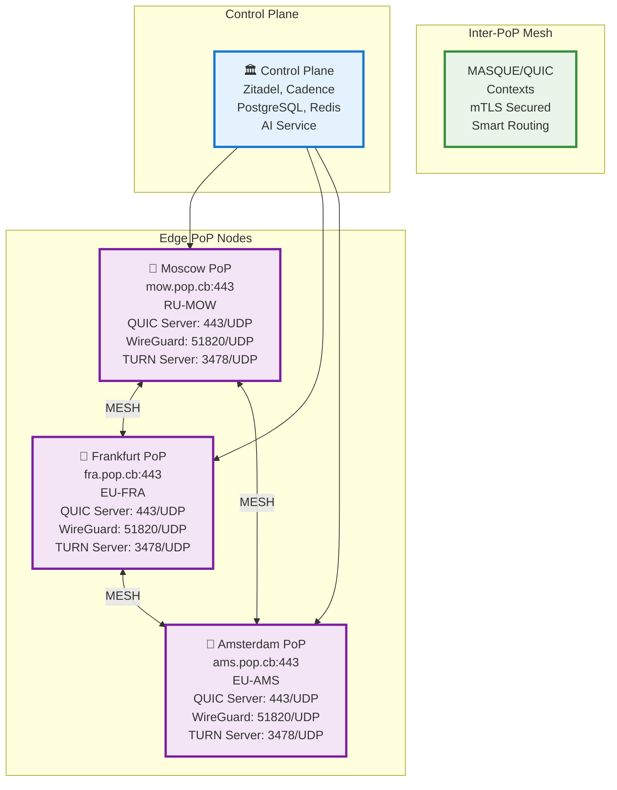

# CloudBridge Edge PoP Nodes

Edge PoP узлы CloudBridge Relay с Inter-PoP MASQUE связностью, умной маршрутизацией и tenant изоляцией.

## Назначение

Этот репозиторий содержит конфигурации для Edge PoP узлов CloudBridge Relay:

- **🏢 Moscow PoP** - RU-MOW региональный узел
- **🏢 Frankfurt PoP** - EU-FRA региональный узел  
- **🏢 Amsterdam PoP** - EU-AMS региональный узел
- **🔗 Inter-PoP MASQUE** - QUIC/MASQUE связность между PoP
- **🛡️ Tenant Isolation** - VRF и Calico Network Policies
- **📊 Metrics Export** - Экспорт метрик для мониторинга

## Архитектура Edge PoP



## Компоненты

### **Moscow PoP (RU-MOW)**
- **Назначение**: Российский региональный узел
- **Функции**: QUIC/MASQUE сервер, WireGuard, TURN, IPAM
- **Конфигурация**: `k8s/relay-mow/`

### **Frankfurt PoP (EU-FRA)**
- **Назначение**: Европейский региональный узел
- **Функции**: QUIC/MASQUE сервер, WireGuard, TURN, IPAM
- **Конфигурация**: `k8s/relay-fra/`

### **Amsterdam PoP (EU-AMS)**
- **Назначение**: Европейский региональный узел
- **Функции**: QUIC/MASQUE сервер, WireGuard, TURN, IPAM
- **Конфигурация**: `k8s/relay-ams/`

### **Inter-PoP MASQUE**
- **Назначение**: Связность между PoP узлами
- **Функции**: QUIC/MASQUE контексты, mTLS, умная маршрутизация
- **Конфигурация**: `masque/`

## Быстрый старт

### **Развертывание Edge PoP**

```bash
# 1. Создание namespace
kubectl create namespace cloudbridge-relay

# 2. Развертывание Moscow PoP
kubectl apply -f k8s/relay-mow/

# 3. Развертывание Frankfurt PoP
kubectl apply -f k8s/relay-fra/

# 4. Развертывание Amsterdam PoP
kubectl apply -f k8s/relay-ams/

# 5. Настройка Inter-PoP MASQUE
kubectl apply -f masque/

# 6. Проверка готовности
kubectl get pods -n cloudbridge-relay
```

### **Проверка связности**

```bash
# Проверка Inter-PoP связности
kubectl exec -n cloudbridge-relay deployment/relay-mow -- \
  curl -X POST http://ai-service:8083/api/routing/test-connectivity \
  -H "Content-Type: application/json" \
  -d '{"source": "MOW", "targets": ["FRA", "AMS"]}'
```

## Конфигурация

### **Relay Deployment**

```yaml
# k8s/relay-mow/relay-deployment.yaml
apiVersion: apps/v1
kind: Deployment
metadata:
  name: relay-mow
  namespace: cloudbridge-relay
spec:
  replicas: 2
  selector:
    matchLabels:
      app: relay
      region: mow
  template:
    metadata:
      labels:
        app: relay
        region: mow
    spec:
      containers:
      - name: relay
        image: cloudbridge/relay:latest
        ports:
        - containerPort: 443
          protocol: UDP
        - containerPort: 9090
          protocol: UDP
        - containerPort: 51820
          protocol: UDP
        - containerPort: 3478
          protocol: UDP
        env:
        - name: REGION
          value: "RU-MOW"
        - name: CONTROL_PLANE_URL
          value: "https://control.2gc.ru"
        - name: ZITADEL_URL
          value: "https://auth.2gc.ru"
        - name: AI_SERVICE_URL
          value: "https://ai.2gc.ru:8083"
        - name: MASQUE_ENABLED
          value: "true"
        - name: INTER_POP_ENABLED
          value: "true"
```

### **Inter-PoP MASQUE Configuration**

```yaml
# masque/masque-config.yaml
apiVersion: v1
kind: ConfigMap
metadata:
  name: masque-config
  namespace: cloudbridge-relay
data:
  masque.yaml: |
    quic:
      port: 9090
      datagrams: true
      bbrv2: true
      ack_frequency: true
      keepalive: 10s
    
    mtls:
      enabled: true
      ca_secret: cb-ca-bundle
      cert_secret: cb-interpop-cert
    
    masque:
      connect_udp: true
      connect_ip: true
      max_contexts: 16384
      tenant_header: x-cb-tenant
    
    neighbors:
      - name: "EU-FRA"
        endpoint: "fra.pop.cb:443"
        region: "EU-FRA"
      - name: "EU-AMS"
        endpoint: "ams.pop.cb:443"
        region: "EU-AMS"
```

### **Tenant Isolation**

```yaml
# k8s/tenant-isolation.yaml
apiVersion: networking.k8s.io/v1
kind: NetworkPolicy
metadata:
  name: tenant-isolation
  namespace: cloudbridge-relay
spec:
  podSelector:
    matchLabels:
      app: relay
  policyTypes:
  - Ingress
  - Egress
  ingress:
  - from:
    - namespaceSelector:
        matchLabels:
          name: cloudbridge-control
    - podSelector:
        matchLabels:
          app: relay
  egress:
  - to:
    - namespaceSelector:
        matchLabels:
          name: cloudbridge-control
    - podSelector:
        matchLabels:
          app: relay
```

## Мониторинг Edge PoP

### **Ключевые метрики**

| Метрика | Описание | SLO Target |
|---------|----------|------------|
| `relay_rtt_seconds` | RTT между PoP | p95 < 50ms |
| `relay_handover_duration_seconds` | Время handover | p95 < 300ms |
| `relay_p2p_percentage` | % P2P соединений | ≥ 60% |
| `relay_error_rate` | Частота ошибок | < 1% |
| `relay_throughput_bytes` | Пропускная способность | > 1Gbps |

### **Grafana Dashboard**

```json
{
  "dashboard": {
    "title": "Edge PoP Dashboard",
    "panels": [
      {
        "title": "Inter-PoP RTT",
        "type": "graph",
        "targets": [
          {
            "expr": "relay_rtt_seconds{region=~\"MOW|FRA|AMS\"}",
            "legendFormat": "{{region}} RTT"
          }
        ]
      },
      {
        "title": "Handover Performance",
        "type": "graph",
        "targets": [
          {
            "expr": "relay_handover_duration_seconds",
            "legendFormat": "Handover Duration"
          }
        ]
      },
      {
        "title": "P2P vs Relay Ratio",
        "type": "stat",
        "targets": [
          {
            "expr": "relay_p2p_percentage",
            "legendFormat": "P2P %"
          }
        ]
      }
    ]
  }
}
```

## Безопасность

### **mTLS между PoP**

```yaml
# masque/mtls-secrets.yaml
apiVersion: v1
kind: Secret
metadata:
  name: cb-interpop-cert
  namespace: cloudbridge-relay
type: kubernetes.io/tls
data:
  tls.crt: <base64-encoded-cert>
  tls.key: <base64-encoded-key>
  ca.crt: <base64-encoded-ca>
```

### **Network Policies**

```yaml
# k8s/network-policies.yaml
apiVersion: networking.k8s.io/v1
kind: NetworkPolicy
metadata:
  name: relay-network-policy
  namespace: cloudbridge-relay
spec:
  podSelector:
    matchLabels:
      app: relay
  policyTypes:
  - Ingress
  - Egress
  ingress:
  - from:
    - namespaceSelector:
        matchLabels:
          name: cloudbridge-control
    - podSelector:
        matchLabels:
          app: relay
    ports:
    - protocol: UDP
      port: 443
    - protocol: UDP
      port: 9090
    - protocol: UDP
      port: 51820
    - protocol: UDP
      port: 3478
```

## Тестирование

### **PoP тесты**

```bash
# Тестирование Moscow PoP
./scripts/test-pop-mow.sh

# Тестирование Frankfurt PoP
./scripts/test-pop-fra.sh

# Тестирование Amsterdam PoP
./scripts/test-pop-ams.sh
```

### **Inter-PoP тесты**

```bash
# Тестирование Inter-PoP связности
./scripts/test-inter-pop-connectivity.sh

# Тестирование MASQUE
./scripts/test-masque.sh

# Тестирование handover
./scripts/test-handover.sh
```

## Масштабирование

### **Горизонтальное масштабирование**

```bash
# Масштабирование Moscow PoP
kubectl scale deployment relay-mow -n cloudbridge-relay --replicas=3

# Масштабирование Frankfurt PoP
kubectl scale deployment relay-fra -n cloudbridge-relay --replicas=3

# Масштабирование Amsterdam PoP
kubectl scale deployment relay-ams -n cloudbridge-relay --replicas=3
```

### **Вертикальное масштабирование**

```yaml
# Увеличение ресурсов
resources:
  requests:
    cpu: "2"
    memory: "4Gi"
  limits:
    cpu: "4"
    memory: "8Gi"
```

## Обновления

### **Rolling update**

```bash
# Обновление всех PoP
kubectl set image deployment/relay-mow relay=cloudbridge/relay:v2.1.0 -n cloudbridge-relay
kubectl set image deployment/relay-fra relay=cloudbridge/relay:v2.1.0 -n cloudbridge-relay
kubectl set image deployment/relay-ams relay=cloudbridge/relay:v2.1.0 -n cloudbridge-relay
```

### **Canary deployment**

```bash
# Canary обновление
kubectl patch deployment relay-mow -n cloudbridge-relay -p '{"spec":{"strategy":{"type":"RollingUpdate","rollingUpdate":{"maxUnavailable":1,"maxSurge":1}}}}'
```

## Документация

- [PoP Configuration](docs/pop-config.md)
- [Inter-PoP MASQUE](docs/inter-pop-masque.md)
- [Tenant Isolation](docs/tenant-isolation.md)
- [Monitoring](docs/monitoring.md)
- [Troubleshooting](docs/troubleshooting.md)

## Участие в разработке

1. Fork репозитория
2. Создайте feature branch
3. Внесите изменения
4. Создайте Pull Request

## Лицензия

MIT License - см. [LICENSE](LICENSE) файл.

## Поддержка

- **Issues**: [GitHub Issues](https://github.com/twogc/cloudbridge-edge-pops/issues)
- **Discussions**: [GitHub Discussions](https://github.com/twogc/cloudbridge-edge-pops/discussions)
- **Documentation**: [Wiki](https://github.com/twogc/cloudbridge-edge-pops/wiki)


