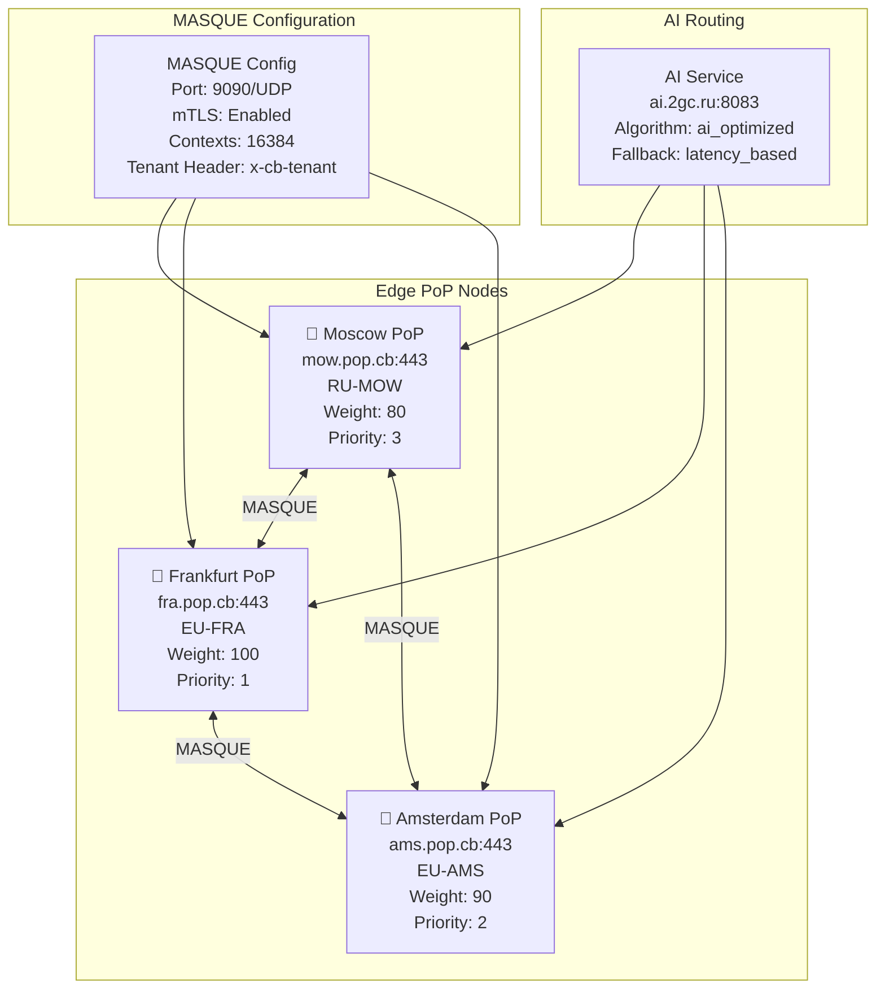

# Inter-PoP MASQUE Configuration

## Overview

Inter-PoP MASQUE обеспечивает связность между Edge PoP узлами через QUIC/MASQUE протокол с поддержкой умной маршрутизации и tenant изоляции.

## Architecture



## Configuration

### MASQUE Settings

| Parameter | Value | Description |
|-----------|-------|-------------|
| Port | 9090/UDP | QUIC/MASQUE порт |
| Protocol | QUIC with MASQUE | Основной протокол |
| Security | mTLS | Взаимная аутентификация |
| Features | BBRv2, ACK Frequency, FEC | Оптимизации производительности |
| Max Contexts | 16384 | Максимальное количество контекстов |
| Tenant Header | x-cb-tenant | Заголовок для изоляции tenant'ов |

### Neighbors Configuration

```yaml
neighbors:
  - name: "EU-FRA"
    endpoint: "fra.pop.cb:443"
    region: "EU-FRA"
    weight: 100
    priority: 1
    latency_threshold: 50ms
    cost_multiplier: 1.0
  - name: "EU-AMS"
    endpoint: "ams.pop.cb:443"
    region: "EU-AMS"
    weight: 90
    priority: 2
    latency_threshold: 45ms
    cost_multiplier: 1.1
  - name: "RU-MOW"
    endpoint: "mow.pop.cb:443"
    region: "RU-MOW"
    weight: 80
    priority: 3
    latency_threshold: 60ms
    cost_multiplier: 0.8
```

### mTLS Configuration

```yaml
mtls:
  enabled: true
  ca_secret: cb-ca-bundle
  cert_secret: cb-interpop-cert
  crl_endpoint: "https://crl.2gc.ru/crl/interpop.crl"
  verify_peer_cert: true
  min_tls_version: "1.3"
```

## Security

### Certificate Management

- **Auto-renewal**: cert-manager с Let's Encrypt
- **CRL Support**: Certificate Revocation List endpoint
- **mTLS**: Взаимная аутентификация между PoP
- **TLS 1.3**: Минимальная версия TLS

### Network Policies

```yaml
# Kubernetes NetworkPolicy
apiVersion: networking.k8s.io/v1
kind: NetworkPolicy
metadata:
  name: relay-network-policy
spec:
  podSelector:
    matchLabels:
      app: cloudbridge-relay
  policyTypes:
  - Ingress
  - Egress
  ingress:
  - from:
    - podSelector:
        matchLabels:
          app: cloudbridge-relay
    ports:
    - protocol: UDP
      port: 9090
    - protocol: UDP
      port: 443
```

### Calico GlobalNetworkPolicy

```yaml
apiVersion: projectcalico.org/v3
kind: GlobalNetworkPolicy
metadata:
  name: inter-pop-allow
spec:
  selector: app == 'cloudbridge-relay'
  egress:
  - action: Allow
    protocol: UDP
    destination:
      ports: [443, 9090, 9092, 51820, 3478, 19302]
    source:
      selector: app == 'cloudbridge-relay'
```

## Monitoring

### Key Metrics

| Metric | Description | SLO Target |
|--------|-------------|------------|
| `masque_active_contexts` | Активные MASQUE контексты | < 80% от max |
| `masque_connections_total` | Общее количество соединений | - |
| `masque_errors_total` | Количество ошибок | < 1% |
| `masque_neighbor_connectivity` | Связность с соседями | = 1 |
| `masque_rtt_seconds` | RTT между PoP | p95 < 50ms |

### Prometheus Configuration

```yaml
scrape_configs:
- job_name: 'masque-inter-pop'
  static_configs:
    - targets:
      - 'masque-mow:9091'
      - 'masque-fra:9091'
      - 'masque-ams:9091'
  relabel_configs:
    - source_labels: [__address__]
      regex: 'masque-(.*):(.*)'
      target_label: region
      replacement: "${1}"
```

## Testing

### Connectivity Tests

```bash
# Тест связности между PoP
./scripts/test-inter-pop-connectivity.sh

# Тест MASQUE функциональности
./scripts/test-masque.sh

# Тест handover
./scripts/test-handover.sh
```

### Manual Testing

```bash
# Проверка MASQUE контекстов
kubectl exec -n cloudbridge-relay deployment/relay-mow -- \
  curl -X GET http://localhost:9090/api/masque/contexts

# Проверка MASQUE статистики
kubectl exec -n cloudbridge-relay deployment/relay-mow -- \
  curl -X GET http://localhost:9090/api/masque/stats

# Проверка соседей
kubectl exec -n cloudbridge-relay deployment/relay-mow -- \
  curl -X GET http://localhost:9090/api/masque/neighbors
```

## Troubleshooting

### Common Issues

#### 1. MASQUE контексты не создаются

**Симптомы:**
- `masque_active_contexts` = 0
- Ошибки в логах: "Failed to create MASQUE context"

**Решение:**
```bash
# Проверка конфигурации
kubectl get configmap masque-config -n cloudbridge-relay -o yaml

# Проверка сертификатов
kubectl get secret cb-interpop-cert -n cloudbridge-relay

# Перезапуск deployment
kubectl rollout restart deployment/relay-mow -n cloudbridge-relay
```

#### 2. Inter-PoP связность нарушена

**Симптомы:**
- `masque_neighbor_connectivity` = 0
- Ошибки в логах: "Connection refused"

**Решение:**
```bash
# Проверка Network Policies
kubectl get networkpolicies -n cloudbridge-relay

# Проверка Calico GlobalNetworkPolicy
kubectl get globalnetworkpolicy inter-pop-allow

# Проверка DNS разрешения
kubectl exec -n cloudbridge-relay deployment/relay-mow -- nslookup fra.pop.cb
```

#### 3. mTLS ошибки

**Симптомы:**
- Ошибки в логах: "TLS handshake failed"
- `masque_errors_total` увеличивается

**Решение:**
```bash
# Проверка сертификатов
kubectl get secret cb-interpop-cert -n cloudbridge-relay -o yaml

# Проверка CA bundle
kubectl get secret cb-ca-bundle -n cloudbridge-relay

# Обновление сертификатов
kubectl delete secret cb-interpop-cert -n cloudbridge-relay
kubectl apply -f masque/mtls-secrets.yaml
```

### Debug Commands

```bash
# Логи MASQUE
kubectl logs -n cloudbridge-relay -l app=cloudbridge-relay --tail=100

# Метрики MASQUE
kubectl port-forward -n cloudbridge-relay svc/relay-mow 9091:9091
curl http://localhost:9091/metrics | grep masque

# Проверка конфигурации
kubectl exec -n cloudbridge-relay deployment/relay-mow -- \
  cat /app/configs/masque.yaml
```

## Performance Tuning

### QUIC Settings

```yaml
quic:
  port: 9090
  datagrams: true
  bbr2: true
  ack_frequency: true
  keepalive: 10s
  congestion_control: bbr2
  max_idle_timeout: 30s
  max_stream_data_bidi_local: 1048576
  max_stream_data_bidi_remote: 1048576
  max_stream_data_uni: 1048576
  max_data: 10485760
  max_streams_bidi: 100
  max_streams_uni: 100
```

### MASQUE Settings

```yaml
masque:
  connect_udp: true
  connect_ip: true
  max_contexts: 16384
  tenant_header: x-cb-tenant
  context_timeout: 300s
  keepalive_interval: 30s
  max_connections_per_tenant: 1000
```

## Scaling

### Horizontal Scaling

```bash
# Масштабирование PoP узлов
kubectl scale deployment relay-mow -n cloudbridge-relay --replicas=3
kubectl scale deployment relay-fra -n cloudbridge-relay --replicas=3
kubectl scale deployment relay-ams -n cloudbridge-relay --replicas=3
```

### Vertical Scaling

```yaml
resources:
  requests:
    memory: "512Mi"
    cpu: "500m"
  limits:
    memory: "1Gi"
    cpu: "1000m"
```

## Future Enhancements

### Planned Features

1. **AI Routing Integration**
   - Machine learning для оптимизации маршрутов
   - Predictive handover
   - Cost optimization

2. **Additional PoP Regions**
   - KZ-ALM (Almaty, Kazakhstan)
   - SG-SIN (Singapore)
   - US-NYC (New York, USA)

3. **Advanced Security**
   - Zero-trust networking
   - End-to-end encryption
   - Quantum-resistant cryptography

### Configuration for New Regions

```yaml
neighbors:
  - name: "KZ-ALM"
    endpoint: "alm.pop.cb:443"
    region: "KZ-ALM"
    weight: 70
    priority: 4
    latency_threshold: 80ms
    cost_multiplier: 0.6
  - name: "SG-SIN"
    endpoint: "sin.pop.cb:443"
    region: "SG-SIN"
    weight: 85
    priority: 5
    latency_threshold: 100ms
    cost_multiplier: 1.2
```
