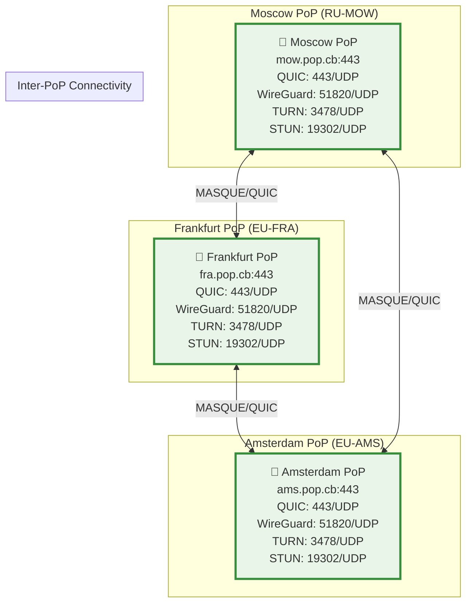

# PoP Configuration Guide

## Overview

Руководство по конфигурации Edge PoP узлов CloudBridge Relay для оптимальной производительности и безопасности.

## PoP Architecture



## Deployment Configuration

### Moscow PoP (RU-MOW)

```yaml
# k8s/relay-mow/cloudbridge-relay-deployment-fixed.yaml
apiVersion: apps/v1
kind: Deployment
metadata:
  name: cloudbridge-relay
  namespace: cloudbridge
  labels:
    app: cloudbridge-relay
    region: mow
    app.kubernetes.io/name: cloudbridge-relay
    app.kubernetes.io/component: relay
spec:
  replicas: 2
  selector:
    matchLabels:
      app: cloudbridge-relay
      region: mow
  template:
    metadata:
      labels:
        app: cloudbridge-relay
        region: mow
        app.kubernetes.io/name: cloudbridge-relay
        app.kubernetes.io/component: relay
    spec:
      containers:
      - name: cloudbridge-relay
        image: cloudbridge-relay:mvp-20251011-214615
        imagePullPolicy: Never
        command: ["./cloudbridge-relay"]
        args: ["--config", "/app/configs/config.json"]
        ports:
        - containerPort: 5550
          name: main-server
          protocol: TCP
        - containerPort: 5551
          name: metrics
          protocol: TCP
        - containerPort: 5552
          name: p2p-api
          protocol: TCP
        - containerPort: 5553
          name: http-api
          protocol: TCP
        - containerPort: 5554
          name: https-api
          protocol: TCP
        - containerPort: 5555
          name: quic-transport
          protocol: UDP
        - containerPort: 9090
          name: quic-legacy
          protocol: UDP
        - containerPort: 9092
          name: enhanced-quic
          protocol: UDP
        - containerPort: 19302
          name: stun-server
          protocol: UDP
        env:
        - name: RELAY_JWT_SECRET
          value: "default-jwt-secret"
        - name: CADENCE_ENABLED
          value: "true"
        - name: CADENCE_HOST_PORT
          value: "cadence:7933"
        - name: CADENCE_DOMAIN
          value: "cloudbridge-p2p"
        - name: CADENCE_TASK_LIST
          value: "p2p-quic-tasks"
        - name: REGION
          value: "RU-MOW"
        - name: CONTROL_PLANE_URL
          value: "https://control.2gc.ru"
        - name: ZITADEL_URL
          value: "https://auth.2gc.ru"
        - name: AI_SERVICE_URL
          value: "https://ai.2gc.ru:8083"
        - name: MASQUE_ENABLED
          value: "true"
        - name: INTER_POP_ENABLED
          value: "true"
        resources:
          requests:
            memory: "256Mi"
            cpu: "250m"
          limits:
            memory: "512Mi"
            cpu: "500m"
        livenessProbe:
          httpGet:
            path: /health
            port: 9091
          initialDelaySeconds: 30
          periodSeconds: 10
        readinessProbe:
          httpGet:
            path: /health
            port: 9091
          initialDelaySeconds: 5
          periodSeconds: 5
        securityContext:
          privileged: true
          capabilities:
            add:
            - NET_ADMIN
            - NET_RAW
            drop:
            - ALL
        volumeMounts:
        - name: config
          mountPath: /app/configs
          readOnly: true
        - name: tls-certs
          mountPath: /app/certs
          readOnly: true
      volumes:
      - name: config
        configMap:
          name: cloudbridge-config-json
      - name: tls-certs
        secret:
          secretName: cloudbridge-tls
```

### Frankfurt PoP (EU-FRA)

```yaml
# k8s/relay-fra/cloudbridge-relay-deployment-fixed.yaml
# Аналогичная конфигурация с изменениями:
env:
- name: REGION
  value: "EU-FRA"
- name: CONTROL_PLANE_URL
  value: "https://control.2gc.ru"
- name: ZITADEL_URL
  value: "https://auth.2gc.ru"
- name: AI_SERVICE_URL
  value: "https://ai.2gc.ru:8083"
```

### Amsterdam PoP (EU-AMS)

```yaml
# k8s/relay-ams/cloudbridge-relay-deployment-fixed.yaml
# Аналогичная конфигурация с изменениями:
env:
- name: REGION
  value: "EU-AMS"
- name: CONTROL_PLANE_URL
  value: "https://control.2gc.ru"
- name: ZITADEL_URL
  value: "https://auth.2gc.ru"
- name: AI_SERVICE_URL
  value: "https://ai.2gc.ru:8083"
```

## Service Configuration

### External Service

```yaml
# k8s/relay-mow/cloudbridge-relay-external-service.yaml
apiVersion: v1
kind: Service
metadata:
  name: cloudbridge-relay-external
  namespace: cloudbridge
  labels:
    app: cloudbridge-relay
    app.kubernetes.io/part-of: cloudbridge-relay
spec:
  type: NodePort
  selector:
    app: cloudbridge-relay
  ports:
    # Main Server
    - name: main-server
      port: 5550
      targetPort: 5550
      nodePort: 30090
      protocol: TCP
    # Metrics
    - name: metrics
      port: 5551
      targetPort: 5551
      nodePort: 30191
      protocol: TCP
    # P2P API  
    - name: p2p-api
      port: 5552
      targetPort: 9091
      nodePort: 30192
      protocol: TCP
    # HTTP API
    - name: http-api
      port: 5553
      targetPort: 5553
      nodePort: 30093
      protocol: TCP
    # STUN Server
    - name: stun-server
      port: 19302
      targetPort: 19302
      nodePort: 30302
      protocol: UDP
    # QUIC Transport
    - name: quic-transport
      port: 9090
      targetPort: 9090
      nodePort: 30094
      protocol: UDP
    # MASQUE Proxy
    - name: masque-proxy
      port: 8443
      targetPort: 8443
      nodePort: 30095
      protocol: TCP
    # Enhanced QUIC
    - name: enhanced-quic
      port: 9092
      targetPort: 9092
      nodePort: 30096
      protocol: UDP
    # P2P QUIC Server
    - name: p2p-quic
      port: 5553
      targetPort: 5553
      nodePort: 30097
      protocol: UDP
```

### LoadBalancer Service

```yaml
# k8s/relay-mow/cloudbridge-relay-lb-tcp.yaml
apiVersion: v1
kind: Service
metadata:
  name: cloudbridge-relay-lb-tcp
  namespace: cloudbridge
  labels:
    app.kubernetes.io/name: cloudbridge-relay
    app.kubernetes.io/component: relay
    app.kubernetes.io/part-of: cloudbridge-relay
  annotations:
    service.beta.kubernetes.io/aws-load-balancer-type: nlb
spec:
  type: LoadBalancer
  selector:
    app.kubernetes.io/name: cloudbridge-relay
    app.kubernetes.io/component: relay
  ports:
  - name: relay-tcp
    port: 9090
    targetPort: 9090
    protocol: TCP
  - name: metrics
    port: 8084
    targetPort: 8084
    protocol: TCP
  - name: p2p-api
    port: 8082
    targetPort: 8082
    protocol: TCP
  - name: grpc
    port: 8444
    targetPort: 8444
    protocol: TCP
```

```yaml
# k8s/relay-mow/cloudbridge-relay-lb-udp.yaml
apiVersion: v1
kind: Service
metadata:
  name: cloudbridge-relay-lb-udp
  namespace: cloudbridge
  labels:
    app.kubernetes.io/name: cloudbridge-relay
    app.kubernetes.io/component: relay
    app.kubernetes.io/part-of: cloudbridge-relay
  annotations:
    service.beta.kubernetes.io/aws-load-balancer-type: nlb
spec:
  type: LoadBalancer
  externalTrafficPolicy: Cluster
  ipFamilyPolicy: PreferDualStack
  selector:
    app.kubernetes.io/name: cloudbridge-relay
    app.kubernetes.io/component: relay
  ports:
  - name: quic-udp
    port: 9090
    targetPort: 9090
    protocol: UDP
  - name: wireguard-udp
    port: 51820
    targetPort: 51820
    protocol: UDP
```

## Port Configuration

### Port Mapping

| Service | Port | Protocol | Description |
|---------|------|----------|-------------|
| Main Server | 5550 | TCP | Основной сервер |
| Metrics | 5551 | TCP | Метрики Prometheus |
| P2P API | 5552 | TCP | P2P API |
| HTTP API | 5553 | TCP | HTTP API |
| HTTPS API | 5554 | TCP | HTTPS API |
| QUIC Transport | 5555 | UDP | QUIC транспорт |
| QUIC Legacy | 9090 | UDP | QUIC legacy |
| Enhanced QUIC | 9092 | UDP | Enhanced QUIC |
| STUN Server | 19302 | UDP | STUN сервер |
| WireGuard | 51820 | UDP | WireGuard VPN |
| TURN Server | 3478 | UDP | TURN сервер |

### NodePort Mapping

| Service | NodePort | Protocol | Description |
|---------|----------|----------|-------------|
| Main Server | 30090 | TCP | Основной сервер |
| Metrics | 30191 | TCP | Метрики |
| P2P API | 30192 | TCP | P2P API |
| HTTP API | 30093 | TCP | HTTP API |
| STUN Server | 30302 | UDP | STUN сервер |
| QUIC Transport | 30094 | UDP | QUIC транспорт |
| MASQUE Proxy | 30095 | TCP | MASQUE прокси |
| Enhanced QUIC | 30096 | UDP | Enhanced QUIC |
| P2P QUIC | 30097 | UDP | P2P QUIC |

## Environment Variables

### Core Configuration

| Variable | Value | Description |
|----------|-------|-------------|
| `RELAY_JWT_SECRET` | `default-jwt-secret` | JWT секрет для аутентификации |
| `CADENCE_ENABLED` | `true` | Включение Cadence workflow |
| `CADENCE_HOST_PORT` | `cadence:7933` | Cadence host и порт |
| `CADENCE_DOMAIN` | `cloudbridge-p2p` | Cadence домен |
| `CADENCE_TASK_LIST` | `p2p-quic-tasks` | Cadence task list |

### Regional Configuration

| Variable | Moscow | Frankfurt | Amsterdam |
|----------|--------|-----------|-----------|
| `REGION` | `RU-MOW` | `EU-FRA` | `EU-AMS` |
| `CONTROL_PLANE_URL` | `https://control.2gc.ru` | `https://control.2gc.ru` | `https://control.2gc.ru` |
| `ZITADEL_URL` | `https://auth.2gc.ru` | `https://auth.2gc.ru` | `https://auth.2gc.ru` |
| `AI_SERVICE_URL` | `https://ai.2gc.ru:8083` | `https://ai.2gc.ru:8083` | `https://ai.2gc.ru:8083` |

### Feature Flags

| Variable | Value | Description |
|----------|-------|-------------|
| `MASQUE_ENABLED` | `true` | Включение MASQUE |
| `INTER_POP_ENABLED` | `true` | Включение Inter-PoP связности |
| `TENANT_ISOLATION_ENABLED` | `true` | Включение изоляции tenant'ов |
| `AI_ROUTING_ENABLED` | `true` | Включение AI маршрутизации |

## Resource Configuration

### Resource Requests

```yaml
resources:
  requests:
    memory: "256Mi"
    cpu: "250m"
```

### Resource Limits

```yaml
resources:
  limits:
    memory: "512Mi"
    cpu: "500m"
```

### Scaling Configuration

```yaml
# Горизонтальное масштабирование
kubectl scale deployment relay-mow -n cloudbridge-relay --replicas=3
kubectl scale deployment relay-fra -n cloudbridge-relay --replicas=3
kubectl scale deployment relay-ams -n cloudbridge-relay --replicas=3

# Вертикальное масштабирование
kubectl patch deployment relay-mow -n cloudbridge-relay -p '{
  "spec": {
    "template": {
      "spec": {
        "containers": [{
          "name": "cloudbridge-relay",
          "resources": {
            "requests": {
              "memory": "512Mi",
              "cpu": "500m"
            },
            "limits": {
              "memory": "1Gi",
              "cpu": "1000m"
            }
          }
        }]
      }
    }
  }
}'
```

## Health Checks

### Liveness Probe

```yaml
livenessProbe:
  httpGet:
    path: /health
    port: 9091
  initialDelaySeconds: 30
  periodSeconds: 10
  timeoutSeconds: 5
  failureThreshold: 3
  successThreshold: 1
```

### Readiness Probe

```yaml
readinessProbe:
  httpGet:
    path: /health
    port: 9091
  initialDelaySeconds: 5
  periodSeconds: 5
  timeoutSeconds: 3
  failureThreshold: 3
  successThreshold: 1
```

### Health Check Endpoints

| Endpoint | Port | Description |
|----------|------|-------------|
| `/health` | 9091 | Основной health check |
| `/ready` | 9091 | Readiness check |
| `/metrics` | 9091 | Prometheus метрики |
| `/api/status` | 5550 | API статус |

## Security Configuration

### Security Context

```yaml
securityContext:
  privileged: true
  capabilities:
    add:
    - NET_ADMIN
    - NET_RAW
    drop:
    - ALL
  runAsUser: 0
  runAsGroup: 0
  runAsNonRoot: false
  readOnlyRootFilesystem: false
  allowPrivilegeEscalation: true
```

### Network Policies

```yaml
# Network Policy для PoP узлов
apiVersion: networking.k8s.io/v1
kind: NetworkPolicy
metadata:
  name: relay-network-policy
  namespace: cloudbridge-relay
spec:
  podSelector:
    matchLabels:
      app: cloudbridge-relay
  policyTypes:
  - Ingress
  - Egress
  ingress:
  - from:
    - podSelector:
        matchLabels:
          app: cloudbridge-relay
    ports:
    - protocol: UDP
      port: 443
    - protocol: UDP
      port: 9090
    - protocol: UDP
      port: 9092
    - protocol: UDP
      port: 51820
    - protocol: UDP
      port: 3478
    - protocol: UDP
      port: 19302
    - protocol: TCP
      port: 5550
    - protocol: TCP
      port: 5551
    - protocol: TCP
      port: 5552
    - protocol: TCP
      port: 5553
    - protocol: TCP
      port: 5554
    - protocol: TCP
      port: 8443
  egress:
  - to:
    - podSelector:
        matchLabels:
          app: cloudbridge-relay
    ports:
    - protocol: UDP
      port: 443
    - protocol: UDP
      port: 9090
    - protocol: UDP
      port: 9092
    - protocol: UDP
      port: 51820
    - protocol: UDP
      port: 3478
    - protocol: UDP
      port: 19302
    - protocol: TCP
      port: 5550
    - protocol: TCP
      port: 5551
    - protocol: TCP
      port: 5552
    - protocol: TCP
      port: 5553
    - protocol: TCP
      port: 5554
    - protocol: TCP
      port: 8443
  - to: []
    ports:
    - protocol: TCP
      port: 53
    - protocol: UDP
      port: 53
    - protocol: TCP
      port: 443
    - protocol: TCP
      port: 80
```

## Monitoring Configuration

### Metrics Endpoints

| Endpoint | Port | Description |
|----------|------|-------------|
| `/metrics` | 9091 | Prometheus метрики |
| `/api/metrics` | 5550 | API метрики |
| `/api/health` | 5550 | Health метрики |

### Prometheus Scrape Configuration

```yaml
scrape_configs:
- job_name: 'edge-pops'
  static_configs:
    - targets: 
      - 'relay-mow:9091'
      - 'relay-fra:9091'
      - 'relay-ams:9091'
  relabel_configs:
    - source_labels: [__address__]
      regex: '(.*):(.*)'
      target_label: region
      replacement: "${1}"
    - source_labels: [__address__]
      regex: 'relay-(.*):.*'
      target_label: pop
      replacement: "${1}"
  metric_relabel_configs:
    - source_labels: [__name__]
      regex: 'relay_.*'
      action: keep
```

## Troubleshooting

### Common Issues

#### 1. Pods не запускаются

**Диагностика:**
```bash
# Проверка статуса подов
kubectl get pods -n cloudbridge-relay -o wide

# Проверка событий
kubectl get events -n cloudbridge-relay --sort-by='.lastTimestamp'

# Проверка логов
kubectl logs -n cloudbridge-relay -l app=cloudbridge-relay --tail=100
```

**Решение:**
```bash
# Проверка ресурсов
kubectl top pods -n cloudbridge-relay

# Проверка конфигурации
kubectl get configmap cloudbridge-config-json -n cloudbridge-relay -o yaml

# Перезапуск deployment
kubectl rollout restart deployment/relay-mow -n cloudbridge-relay
```

#### 2. Health checks не проходят

**Диагностика:**
```bash
# Проверка health endpoint
kubectl exec -n cloudbridge-relay deployment/relay-mow -- \
  curl -f http://localhost:9091/health

# Проверка портов
kubectl exec -n cloudbridge-relay deployment/relay-mow -- \
  netstat -tulpn | grep 9091
```

**Решение:**
```bash
# Проверка конфигурации health checks
kubectl get deployment relay-mow -n cloudbridge-relay -o yaml | grep -A 10 livenessProbe

# Обновление health check конфигурации
kubectl patch deployment relay-mow -n cloudbridge-relay -p '{
  "spec": {
    "template": {
      "spec": {
        "containers": [{
          "name": "cloudbridge-relay",
          "livenessProbe": {
            "httpGet": {
              "path": "/health",
              "port": 9091
            },
            "initialDelaySeconds": 30,
            "periodSeconds": 10
          }
        }]
      }
    }
  }
}'
```

#### 3. Метрики не собираются

**Диагностика:**
```bash
# Проверка metrics endpoint
kubectl exec -n cloudbridge-relay deployment/relay-mow -- \
  curl -f http://localhost:9091/metrics

# Проверка Prometheus targets
kubectl port-forward -n cloudbridge-relay svc/prometheus 9090:9090
curl http://localhost:9090/api/v1/targets
```

**Решение:**
```bash
# Проверка Network Policies
kubectl get networkpolicies -n cloudbridge-relay

# Проверка Service конфигурации
kubectl get service -n cloudbridge-relay | grep metrics

# Обновление Service
kubectl apply -f k8s/relay-mow/cloudbridge-relay-external-service.yaml
```

## Best Practices

### Configuration Management

1. **Использование ConfigMaps:**
   - Хранение конфигурации в ConfigMaps
   - Версионирование конфигурации
   - Отдельные ConfigMaps для каждого региона

2. **Secrets Management:**
   - Использование Kubernetes Secrets
   - Шифрование секретов
   - Регулярная ротация секретов

3. **Environment Variables:**
   - Явное задание всех переменных
   - Использование значений по умолчанию
   - Документирование всех переменных

### Security

1. **Network Security:**
   - Настройка Network Policies
   - Использование Calico GlobalNetworkPolicy
   - Ограничение доступа по портам

2. **Container Security:**
   - Использование минимальных образов
   - Ограничение привилегий
   - Регулярное обновление образов

3. **Secrets Security:**
   - Шифрование секретов
   - Регулярная ротация
   - Аудит доступа к секретам

### Monitoring

1. **Health Checks:**
   - Настройка liveness и readiness probes
   - Мониторинг health endpoints
   - Алерты при недоступности

2. **Metrics:**
   - Экспорт метрик в Prometheus
   - Настройка алертов
   - Мониторинг производительности

3. **Logging:**
   - Централизованное логирование
   - Структурированные логи
   - Аудит действий

