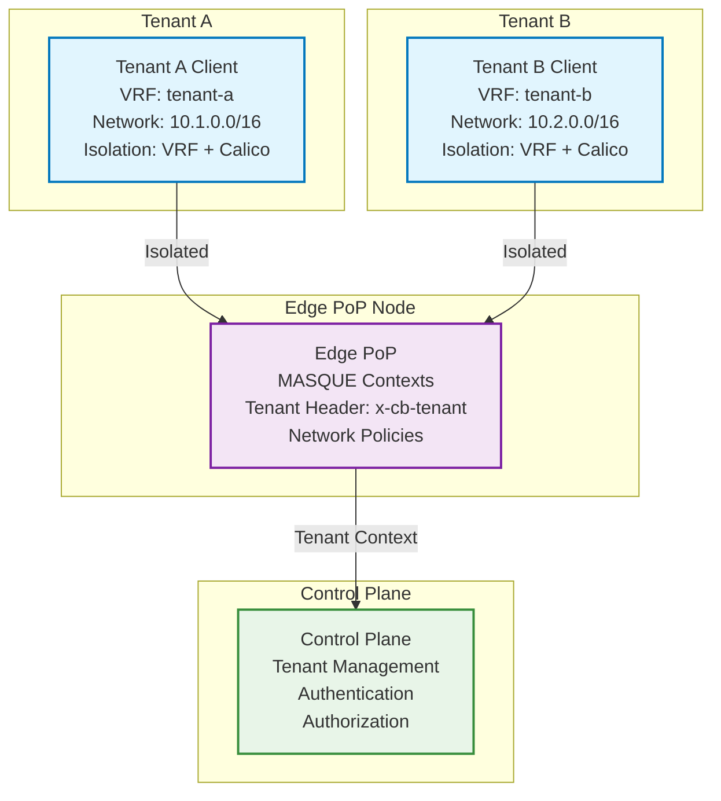

# Tenant Isolation

## Overview

Система изоляции tenant'ов в Edge PoP узлах CloudBridge Relay обеспечивает полную изоляцию трафика и ресурсов между различными клиентами.

## Architecture



## Isolation Layers

### 1. Network Level Isolation

#### VRF (Virtual Routing and Forwarding)
```yaml
# VRF конфигурация для каждого tenant
apiVersion: v1
kind: ConfigMap
metadata:
  name: tenant-vrf-config
  namespace: cloudbridge-relay
data:
  tenant-a.yaml: |
    vrf:
      name: "tenant-a"
      table_id: 1001
      routes:
        - network: "10.1.0.0/16"
          gateway: "10.1.1.1"
        - network: "10.1.2.0/24"
          gateway: "10.1.2.1"
  
  tenant-b.yaml: |
    vrf:
      name: "tenant-b"
      table_id: 1002
      routes:
        - network: "10.2.0.0/16"
          gateway: "10.2.1.1"
        - network: "10.2.2.0/24"
          gateway: "10.2.2.1"
```

#### Calico Network Policies
```yaml
# Tenant-specific Network Policy
apiVersion: projectcalico.org/v3
kind: NetworkPolicy
metadata:
  name: tenant-a-isolation
  namespace: cloudbridge-relay
spec:
  selector: tenant == 'tenant-a'
  order: 100
  ingress:
  - action: Allow
    protocol: UDP
    source:
      selector: tenant == 'tenant-a'
    destination:
      ports: [443, 9090, 9092]
  - action: Allow
    protocol: TCP
    source:
      selector: tenant == 'tenant-a'
    destination:
      ports: [5550, 5551, 5552, 5553, 5554]
  egress:
  - action: Allow
    protocol: UDP
    destination:
      selector: tenant == 'tenant-a'
    source:
      ports: [443, 9090, 9092]
  - action: Allow
    protocol: TCP
    destination:
      selector: tenant == 'tenant-a'
    source:
      ports: [5550, 5551, 5552, 5553, 5554]
```

### 2. Application Level Isolation

#### MASQUE Context Isolation
```yaml
# MASQUE конфигурация с tenant изоляцией
masque:
  connect_udp: true
  connect_ip: true
  max_contexts: 16384
  tenant_header: x-cb-tenant
  context_timeout: 300s
  keepalive_interval: 30s
  max_connections_per_tenant: 1000
  
  tenant_isolation:
    enabled: true
    vrf_enabled: true
    network_policies: true
    context_separation: true
    resource_limits:
      cpu_per_tenant: "100m"
      memory_per_tenant: "256Mi"
      connections_per_tenant: 1000
```

#### Tenant Header Processing
```yaml
# Обработка tenant заголовков
tenant_processing:
  header_name: "x-cb-tenant"
  validation:
    required: true
    format: "uuid"
    max_length: 36
  routing:
    tenant_context: true
    vrf_lookup: true
    network_separation: true
```

### 3. Resource Level Isolation

#### Kubernetes Resource Quotas
```yaml
# Resource Quota для каждого tenant
apiVersion: v1
kind: ResourceQuota
metadata:
  name: tenant-a-quota
  namespace: cloudbridge-relay
spec:
  hard:
    requests.cpu: "500m"
    requests.memory: "1Gi"
    limits.cpu: "1000m"
    limits.memory: "2Gi"
    pods: "10"
    services: "5"
    configmaps: "10"
    secrets: "10"
  scopeSelector:
    matchExpressions:
    - operator: In
      scopeName: Tenant
      values: ["tenant-a"]
```

#### Limit Ranges
```yaml
# Limit Range для tenant ресурсов
apiVersion: v1
kind: LimitRange
metadata:
  name: tenant-limit-range
  namespace: cloudbridge-relay
spec:
  limits:
  - type: Container
    max:
      cpu: "1000m"
      memory: "2Gi"
    min:
      cpu: "100m"
      memory: "128Mi"
    default:
      cpu: "500m"
      memory: "1Gi"
    defaultRequest:
      cpu: "250m"
      memory: "512Mi"
```

## Security Policies

### Network Security

#### Ingress Rules
```yaml
# Правила входящего трафика
ingress_rules:
  - name: "tenant-a-ingress"
    selector: tenant == 'tenant-a'
    rules:
      - action: Allow
        protocol: UDP
        source:
          selector: tenant == 'tenant-a'
        destination:
          ports: [443, 9090, 9092, 51820, 3478, 19302]
      - action: Allow
        protocol: TCP
        source:
          selector: tenant == 'tenant-a'
        destination:
          ports: [5550, 5551, 5552, 5553, 5554, 8443]
      - action: Deny
        protocol: UDP
        source:
          selector: tenant != 'tenant-a'
      - action: Deny
        protocol: TCP
        source:
          selector: tenant != 'tenant-a'
```

#### Egress Rules
```yaml
# Правила исходящего трафика
egress_rules:
  - name: "tenant-a-egress"
    selector: tenant == 'tenant-a'
    rules:
      - action: Allow
        protocol: UDP
        destination:
          selector: tenant == 'tenant-a'
        source:
          ports: [443, 9090, 9092, 51820, 3478, 19302]
      - action: Allow
        protocol: TCP
        destination:
          selector: tenant == 'tenant-a'
        source:
          ports: [5550, 5551, 5552, 5553, 5554, 8443]
      - action: Allow
        protocol: TCP
        destination:
          ports: [53, 443, 80]
      - action: Deny
        protocol: UDP
        destination:
          selector: tenant != 'tenant-a'
      - action: Deny
        protocol: TCP
        destination:
          selector: tenant != 'tenant-a'
```

### Application Security

#### Authentication
```yaml
# Аутентификация tenant'ов
authentication:
  method: "jwt"
  header: "Authorization"
  format: "Bearer <token>"
  validation:
    issuer: "https://auth.2gc.ru"
    audience: "cloudbridge-relay"
    algorithm: "RS256"
  tenant_extraction:
    from_token: true
    claim_name: "tenant_id"
    fallback_header: "x-cb-tenant"
```

#### Authorization
```yaml
# Авторизация tenant'ов
authorization:
  rbac:
    enabled: true
    rules:
      - tenant: "tenant-a"
        resources: ["masque", "relay", "metrics"]
        actions: ["read", "write", "connect"]
        conditions:
          - field: "source_ip"
            operator: "in"
            values: ["10.1.0.0/16"]
      - tenant: "tenant-b"
        resources: ["masque", "relay", "metrics"]
        actions: ["read", "write", "connect"]
        conditions:
          - field: "source_ip"
            operator: "in"
            values: ["10.2.0.0/16"]
```

## Monitoring and Auditing

### Tenant Metrics

| Metric | Description | Labels |
|--------|-------------|--------|
| `tenant_connections_total` | Количество соединений по tenant | `tenant`, `region` |
| `tenant_bandwidth_bytes` | Пропускная способность по tenant | `tenant`, `region` |
| `tenant_errors_total` | Количество ошибок по tenant | `tenant`, `region`, `error_type` |
| `tenant_contexts_active` | Активные контексты по tenant | `tenant`, `region` |
| `tenant_resource_usage` | Использование ресурсов по tenant | `tenant`, `resource_type` |

### Audit Logging

```yaml
# Конфигурация аудита
audit_logging:
  enabled: true
  level: "info"
  format: "json"
  fields:
    - "timestamp"
    - "tenant_id"
    - "user_id"
    - "action"
    - "resource"
    - "result"
    - "source_ip"
    - "user_agent"
  retention:
    days: 90
    max_size: "10GB"
  destinations:
    - "stdout"
    - "file:///var/log/audit/tenant-audit.log"
    - "syslog://audit.2gc.ru:514"
```

### Compliance Monitoring

```yaml
# Мониторинг соответствия требованиям
compliance_monitoring:
  enabled: true
  checks:
    - name: "tenant_isolation"
      description: "Проверка изоляции tenant'ов"
      query: "tenant_connections_total{tenant!=\"\"}"
      threshold: 0
      operator: "gt"
    - name: "resource_quota"
      description: "Проверка лимитов ресурсов"
      query: "tenant_resource_usage / tenant_resource_quota"
      threshold: 0.8
      operator: "gt"
    - name: "network_policy"
      description: "Проверка Network Policies"
      query: "network_policy_violations_total"
      threshold: 0
      operator: "gt"
```

## Troubleshooting

### Common Issues

#### 1. Tenant Isolation Violations

**Симптомы:**
- Ошибки в логах: "Tenant isolation violation"
- Метрики показывают cross-tenant трафик
- Алерты "TenantIsolationViolation"

**Диагностика:**
```bash
# Проверка Network Policies
kubectl get networkpolicies -n cloudbridge-relay -o yaml

# Проверка Calico GlobalNetworkPolicy
kubectl get globalnetworkpolicy -o yaml

# Проверка логов
kubectl logs -n cloudbridge-relay -l app=cloudbridge-relay | grep -i "tenant isolation"

# Проверка метрик
kubectl port-forward -n cloudbridge-relay svc/relay-mow 9091:9091
curl http://localhost:9091/metrics | grep tenant
```

**Решение:**
```bash
# Обновление Network Policies
kubectl apply -f masque/network-policies.yaml

# Проверка VRF конфигурации
kubectl get configmap tenant-vrf-config -n cloudbridge-relay -o yaml

# Перезапуск deployment
kubectl rollout restart deployment/relay-mow -n cloudbridge-relay
```

#### 2. Resource Quota Exceeded

**Симптомы:**
- Ошибки в логах: "Resource quota exceeded"
- Pods не могут быть созданы
- Алерты "ResourceQuotaExceeded"

**Диагностика:**
```bash
# Проверка Resource Quotas
kubectl get resourcequotas -n cloudbridge-relay

# Проверка использования ресурсов
kubectl top pods -n cloudbridge-relay

# Проверка Limit Ranges
kubectl get limitranges -n cloudbridge-relay
```

**Решение:**
```bash
# Увеличение Resource Quota
kubectl patch resourcequota tenant-a-quota -n cloudbridge-relay -p '{
  "spec": {
    "hard": {
      "requests.cpu": "1000m",
      "requests.memory": "2Gi",
      "limits.cpu": "2000m",
      "limits.memory": "4Gi"
    }
  }
}'

# Проверка статуса
kubectl get resourcequotas -n cloudbridge-relay
```

#### 3. Authentication Failures

**Симптомы:**
- Ошибки в логах: "Authentication failed"
- Метрики показывают высокий уровень auth failures
- Алерты "AuthenticationFailure"

**Диагностика:**
```bash
# Проверка JWT токенов
kubectl exec -n cloudbridge-relay deployment/relay-mow -- \
  curl -H "Authorization: Bearer <token>" http://localhost:5550/api/auth/validate

# Проверка конфигурации аутентификации
kubectl get configmap masque-config -n cloudbridge-relay -o yaml | grep -A 10 authentication

# Проверка логов аутентификации
kubectl logs -n cloudbridge-relay -l app=cloudbridge-relay | grep -i "auth"
```

**Решение:**
```bash
# Обновление JWT секрета
kubectl create secret generic jwt-secret \
  --from-literal=secret="new-jwt-secret" \
  -n cloudbridge-relay

# Проверка аутентификации
kubectl exec -n cloudbridge-relay deployment/relay-mow -- \
  curl -H "Authorization: Bearer <token>" http://localhost:5550/api/auth/validate
```

## Best Practices

### Security

1. **Принцип минимальных привилегий:**
   - Каждый tenant имеет доступ только к своим ресурсам
   - Network Policies настроены для максимальной изоляции
   - Resource Quotas ограничивают использование ресурсов

2. **Регулярный аудит:**
   - Еженедельная проверка логов на нарушения изоляции
   - Ежемесячная проверка соответствия политикам
   - Ежеквартальная проверка безопасности

3. **Мониторинг:**
   - Настройка алертов для всех нарушений изоляции
   - Регулярная проверка метрик tenant'ов
   - Анализ трендов использования ресурсов

### Performance

1. **Оптимизация ресурсов:**
   - Настройка Resource Quotas в соответствии с потребностями
   - Мониторинг использования ресурсов
   - Автоматическое масштабирование при необходимости

2. **Сетевая оптимизация:**
   - Использование VRF для изоляции трафика
   - Оптимизация Network Policies
   - Мониторинг сетевой производительности

### Compliance

1. **Соответствие требованиям:**
   - Регулярная проверка соответствия политикам
   - Документирование всех изменений
   - Аудит доступа и действий

2. **Отчетность:**
   - Еженедельные отчеты по изоляции tenant'ов
   - Ежемесячные отчеты по использованию ресурсов
   - Ежеквартальные отчеты по безопасности
